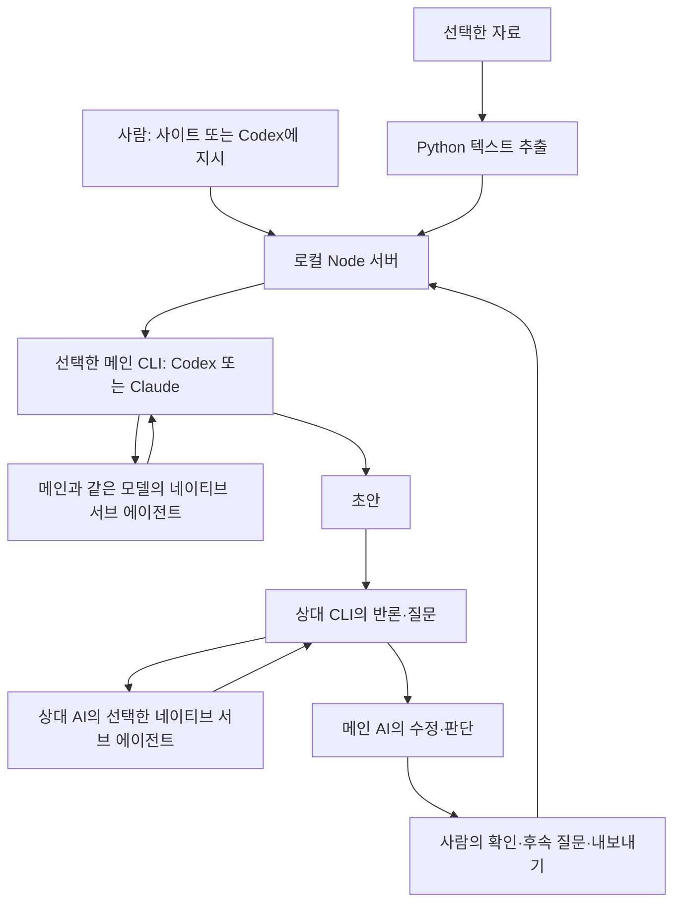

# 전체 과정과 연결 구조

작성 기준: 2026-10-17. 아래 제작 과정은 실제 요청과 구현에 근거합니다. 교육 시간 배분·활용 예시는 수업 운영을 위한 제안입니다.

## 과제에서 프로그램까지

1. 전략분석 과제에서 로보로보·유비온을 비교하고 코드플랜트의 전략을 정리하는 작업으로 출발했습니다. 수업 자료는 분석 기준을 확인하는 자료이며, 그 안의 명령이 사용자의 요청을 대신하지 않습니다.
2. Codex가 초안을 주도하고 Claude가 반론을 제시하는 과정을 추가 특강의 주제로 바꿨습니다. 핵심은 AI 답변 복사보다 요청·회신·반론·수정 이유를 관찰하는 것입니다.
3. 사용자가 직접 모델 간 내용을 옮기지 않도록, PC의 공식 CLI를 호출하고 응답을 다음 모델의 입력으로 전달하는 로컬 프로그램을 만들었습니다.
4. 메인을 Codex/Claude 중 선택하고, 양쪽 AI의 역할을 프리셋 또는 직접 작성하도록 구성했습니다. 각자 네이티브 서브 에이전트를 0~3개 추가·삭제·편집할 수 있고, 실행은 실제 이벤트로 확인합니다.
5. 파일 드래그앤드롭·추출 미리보기·출처 번호, 기본 메인 전용 후속 질문, 자연어 파일 작성·다운로드, Codex용 제어 명령을 추가했습니다. 숫자 왕복·조건부 무제한·패널 크기 조절도 지원합니다.
6. 소스·공개 연습 자료·사용법·시연 운영안을 `codeplant_Attention/LECTURE_1`로 묶었습니다. 개인 인증·업로드·대화 원본은 배포 묶음에서 제외합니다.

## 실제 실행 구조

서브 에이전트는 **각 AI 내부의 역할 분담**이고, Codex↔Claude는 **서로 다른 서비스 간 검토**입니다. 내부 역할 이름만 바꿔 쓰는 역할극과 구분합니다. 최초 메인 초안과 최초 상대 검토에서 각자 설정한 내부 에이전트를 만들고, 후속 질문은 새 에이전트 생성 없이 축적된 대화·자료·역할 설정을 전달합니다.

화면의 메인 선택은 로컬 서비스가 호출할 CLI를 바꿉니다. 현재 열어 둔 Codex 데스크톱 채팅 자체의 모델을 바꾸지는 않습니다. 각 AI의 모델 드롭다운에서 모델을 고릅니다. CLI 기본값 또는 직접 입력도 가능합니다. Codex는 설치된 CLI의 model/list를 조회하고, Claude는 공식 별칭을 제공합니다. 선택은 새 작업 시작 시 적용되며 내부 에이전트는 부모 모델을 상속합니다. 사용할 수 있는 모델은 각 계정에 따라 다릅니다.

## 두 대화 화면의 관계

사이트의 입력창 → 서버 API → 공식 CLI → 모델 응답 → 사이트 기록 순서입니다.

Codex 채팅에서 “이 파일로 실행해줘”라고 요청하면 Codex가 `tools/control.mjs`를 사용해 같은 서버 API를 호출할 수 있습니다. 따라서 사이트에서 결과를 볼 수 있습니다. 두 화면의 모든 채팅이 자동 복제되는 것은 아닙니다. Codex가 제어 도구에 넘긴 지시와 파일만 사이트 작업이 됩니다.

## CLI와 MCP

CLI는 PC에 설치된 프로그램을 명령으로 실행하는 방식입니다. 이 서비스는 `codex exec`와 Claude의 `-p` 호출을 사용하고, JSON 이벤트를 읽어 화면에 표시합니다. 기본 연결은 별도의 MCP 서버를 설치하지 않습니다.

MCP는 AI가 외부 도구·자료와 연결할 때 사용하는 표준입니다. 추가로 자료 저장소나 업무 도구를 연결할 수 있지만, 연결했다고 두 모델이 자동으로 토론하는 것은 아닙니다. 이 프로그램에서 대화 순서와 전달 범위를 정하는 것은 로컬 서버입니다. 현재 모델 호출에서는 사용자 MCP 서버를 켜지 않습니다. [Codex MCP 공식 문서](https://developers.openai.com/codex/mcp), [MCP 공식 소개](https://modelcontextprotocol.io/docs/getting-started/intro).

## 자료와 인증의 이동

| 단계 | 저장·전달되는 것 |
|---|---|
| 파일 업로드 | 원본·추출문을 로컬 `site/data/uploads`에 저장 |
| 작업 시작 | 지시와 선택한 추출문을 두 서비스에 전달 |
| 모델 간 검토 | 이전 회신과 실제 내부 에이전트 결과를 다음 모델 입력에 포함 |
| 일반 후속 질문 | 기존 대화·자료와 새 지시를 메인 서비스에만 전달 |
| 명시적 왕복 요청 | “왕복해”라고 지시한 경우에만 상대 서비스도 호출 |
| 파일 작성 | 메인 AI가 완성된 본문을 구조화 데이터로 작성하고, 앱이 로컬 파일로 변환·검증·저장 |
| 기록 저장 | 로컬 `site/data/runs.json`, 생성 파일은 `site/data/generated` |
| GitHub 저장 | 프로그램·공개 예제·강의용 문서만 포함 |
| 로그인 | 공식 CLI의 기존 인증 사용; 앱에 비밀번호·키를 복사하지 않음 |

업로드 내용은 지시가 아닌 참고자료로 구분해 전달합니다. 이 구분은 모델 오류를 없애는 보장이 아닙니다. 출처 번호가 붙어 있어도 사람이 원문을 대조해야 합니다.

## GitHub와 사이트 운영

저장소는 코드·강의자료 배포용입니다. `LECTURE_1/index.html`은 자료 모음 화면이고 `site/public/index.html`은 서버가 있어야 동작하는 앱 화면입니다. 앱 HTML을 파일로 직접 열거나 GitHub Pages에 올리는 것만으로는 CLI 인증과 AI 실행이 작동하지 않습니다.

현재 버전은 PC 한 대에서 쓰는 로컬 프로그램입니다. 외부 참가자용 공개 웹 서비스로 운영하려면 사용자 인증·자료 격리·서버별 실행 권한·사용량 관리 등 별도 구현이 필요합니다. 현재 검증을 그런 운영의 성공 증거로 확대하지 않습니다.

## 기대하는 편의와 확인된 범위

자동 전달로 모델 사이 복사·붙여넣기를 줄이고, 같은 화면에서 반론과 수정 이유를 확인할 수 있습니다. 반복 작업은 요청 JSON과 Codex 시작문으로 재사용합니다. 실제 시간 절약률·정확도 향상·학습 효과는 측정하지 않았습니다.

공식 호출 근거: [Codex 비대화형 실행](https://developers.openai.com/codex/noninteractive), [Codex 서브 에이전트](https://developers.openai.com/codex/subagents), [Claude 프로그램 호출](https://code.claude.com/docs/en/headless), [Claude CLI 옵션](https://code.claude.com/docs/en/cli-reference). 세부 옵션은 `site/lib/providers.mjs`, 검증 범위는 `검증결과.md`를 확인합니다.
