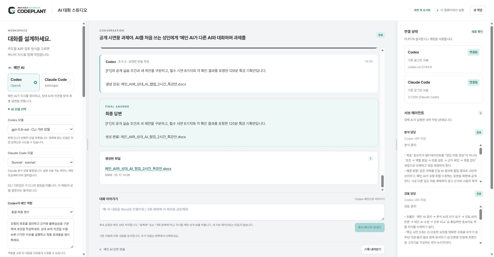

# 검증 결과

확인일: 2026-10-17. 이 PC의 Windows·Edge와 설치된 CLI를 기준으로 확인했습니다.

## 자동 확인

- 서비스 Node 테스트 26개 통과: 기존 흐름·역할·업로드·중지·보안 검사와 함께, 4회 이상 직접 입력·조건부 무제한·수동 중지·메인 전용 후속·명시한 왕복·상대 로그아웃 시 처리·자연어 DOCX 생성·다운로드·파일 형식과 경로 검증. 모델 목록의 숨김·잘못된 ID 필터, 선택 ID의 CLI 전달과 긴 대화의 메인 전용 요약·원문 보존도 확인.
- UI 이벤트 테스트 10개 통과: 드롭 파일 전달·이동 방지·업로드 상태, 왕복 직접 입력과 무제한, 패널 최소 폭·저장·복원·포인터와 키보드 조절·초기화. 모델 선택·직접 입력·조회 실패 시 선택 보존과 비활성 모델 차단도 확인.
- Python 테스트 7개 통과: 문서 추출 4개와 생성 파일 3개. 실제 DOCX 제목·본문·표, PDF 페이지·텍스트, PPTX 슬라이드, XLSX 셀 데이터와 수식 비실행, 코드 파일 비실행, CSV 수식 입력 보호를 확인.
- 테스트의 CLI는 모의 구현입니다. 실제 모델의 응답 성공으로 간주하지 않습니다.

자동 확인 합계: Node 36개 + Python 7개 = 43개 통과.

## 실제 확인

- Codex 메인 → 내부 역할 2개 생성·완료 → Claude 검토 → Codex 최종 답변 완료.
- Claude 메인 → 내부 역할 2개 생성·완료 → Codex 검토 → Claude 최종 답변 완료.
- 양쪽 역할을 직접 지정한 새 작업에서 Codex의 ‘교육 흐름’ 1개, Claude의 ‘시간 검토’ 1개가 각각 실제 생성·완료됨. 두 하위 결과가 최종 답변에 반영된 대화 완료 확인.
- 공개 실습자료 MD를 Edge의 파일 선택으로 업로드하고, 추출 335자·선택 상태가 화면에 표시되는 것을 확인.
- 이전 v0.3의 후속 왕복에서 `[F1]` 조건과 새 제안이 구분된 실제 답변을 확인. v0.4부터는 일반 후속은 메인만 처리하고, 명시적으로 왕복을 요청할 때만 상대를 호출하도록 변경.
- 후속 단계에서는 새 내부 에이전트를 생성하지 않고 기존 에이전트 결과와 대화를 유지.
- 서버 재시작 후 이전 두 작업 보존, 업로드 메타데이터와 작업별 자료 저장 확인.
- Edge에서 메인·상대 역할 프리셋 선택 시 작성문이 바뀌는 것, 상대 서브 에이전트 추가와 역할 프리셋 적용 확인.
- Codex용 control.mjs로 실제 서비스 상태 확인·공개 파일 업로드·새 작업 실행·Markdown 내보내기 확인.

실제 실행 시 설치 버전은 Codex CLI 0.144.6, Claude Code 2.1.300이었습니다. 기본 모델은 각 CLI 설정에 따릅니다. 다른 버전·계정에서는 재검증이 필요합니다. 현재 파일 추출 자동 테스트에 사용한 Python은 3.12, pypdf는 6.10.2입니다.

## v0.4.1 추가 실제 확인

- 실제 Edge 이어가기에 “이 내용을 Word로 만들어줘.” 입력 → 메인 Codex 호출 1회 → 실제 DOCX 생성·다운로드 성공. 이 요청에서 Claude 호출은 추가되지 않았음.
- 다운로드한 66,966바이트 DOCX를 LibreOffice로 PDF·페이지 이미지로 렌더링하고 총 6페이지를 모두 육안 검수. 제목·본문·표·페이지 번호가 읽히며 잘림 없음. 문서 내용의 정확성 전체를 보증하는 검사는 아님.
- 숫자 직접 입력 5회·무제한 종료 조건 필드 표시, 왼쪽 패널 키보드 폭 조절 310→330px, 오른쪽 패널 실제 마우스 드래그 278→368px 확인.
- 실제 Edge 화면에서 Codex gpt-5.6-sol과 Claude Sonnet을 드롭다운으로 선택하고 새로 확인 후에도 선택 유지 확인. 패널 폭 330/368px는 페이지 새로고침 후 복원됨.
- 설치된 Codex `model/list`는 gpt-5.6-sol·gpt-5.6-terra·gpt-5.6-luna를 반환. gpt-6-sol을 지정한 실제 짧은 호출은 실패했으므로 사용 가능 모델로 표시하지 않음. 이 결과는 현재 PC·CLI·계정 기준. Claude는 공식 별칭을 표시하며 모든 별칭을 각각 실제 호출한 것은 아님.

## 확인하지 않은 것과 제한

- 새 Windows PC에서의 처음부터 설치, 다른 OS, 모바일·스크린리더 사용은 검증하지 않았습니다.
- 파일 드롭 이벤트의 파일 전달·브라우저 이동 방지는 테스트로 확인했습니다. OS 파일 탐색기에서 브라우저로 직접 끌어오는 동작은 별도 실기 검증하지 않았습니다. 파일 선택 버튼을 이용한 실제 업로드는 확인했습니다.
- 실제 개인·고객 자료는 외부로 보내 검증하지 않았습니다. 회사 전략 보고서의 타당성을 이 앱 검증 결과로 보증하지 않습니다.
- 스캔 OCR·이미지 생성·도표 해석, 복잡한 양식 재현·계산식·HWP 제작은 현재 기능에 없습니다. 파일 생성은 기본 문서·텍스트 슬라이드·표 데이터 기준입니다.
- 클라우드 공개 호스팅·동시 다중 사용자·계정별 자료 격리·상용 서비스 운영을 검증하지 않았습니다.
- 정확도 개선·시간 절감·학습 효과는 측정하지 않았습니다.
- CLI의 네이티브 이벤트와 옵션은 업데이트 시 바뀔 수 있습니다. 서브 에이전트 관찰에 실패하면 성공으로 처리하지 않습니다.
- 중지는 로컬 실행과 다음 호출을 막으며 원격에서 이미 처리한 사용량은 취소를 보장하지 않습니다.

강의시간·활용 예시는 교육 설계입니다. 실제 확인 결과와 구분해 설명합니다. 원본 대학교 수업자료·개인 인증·개인 실행 기록은 저장소에 포함하지 않았습니다. 캡처는 공개 시연 과제로 생성한 화면입니다.

## v0.5 Gemini·단독 사용 검증

- Node 36개 통과. 세 제공자 각각 하나만 연결된 조건에서 새 작업·메인 전용 이어가기·실제 파일 렌더링·다운로드를 확인했다(모델 응답은 모의 구현).
- 메인/상대만 연결됐을 때 선택하지 않은 세 번째 제공자는 요구하지 않는다. 상대 미선택·동일 제공자·선택 상대의 로그아웃은 오류로 구분했다.
- Gemini 스트림의 init·assistant delta·result/error를 검사했다. 테스트용 실제 Node 자식 프로세스로 마지막 줄 무개행·응답 취합·사용자 중지·도구 제한 설정 경로를 확인했다. Google 요청은 보내지 않은 테스트다.
- 실제 PC에 공식 Gemini CLI 0.64.0을 설치하고 버전·로그인 필요 표시를 확인했다. Google 로그인 기록이 없으므로 실제 Gemini 응답·모델별 호출·OAuth 로그인 완료는 미검증이다.
- Gemini 내부 에이전트는 앱에서 지원하지 않으며 UI 안내·API 검증으로 제한한다.
